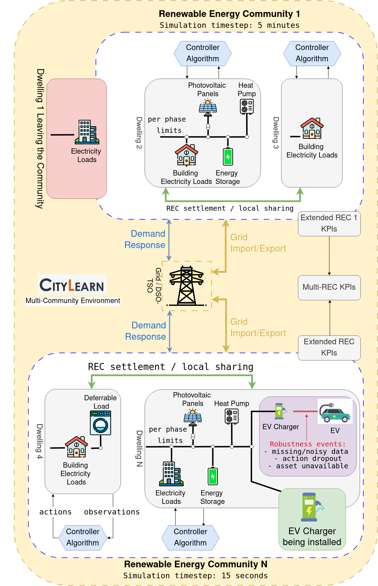

=========
CityLearn
=========

CityLearn is an open-source Gymnasium environment for building energy coordination,
demand response and reinforcement learning :cite:p:`https://doi.org/10.48550/arxiv.2012.10504, 10.1145/3360322.3360998, doi:10.1080/19401493.2024.2418813`.
It provides a common environment in which controllers can be tested using the
same scenarios, interfaces and performance indicators.

CityLearn v3 extends this foundation to configurable renewable energy communities:
buildings, PV, batteries, EVs and flexible loads can be studied with service
deadlines, electrical limits, local settlement, changing members and assets,
and data or equipment failures. It incorporates the extensions developed by
the Soft-CPS Research Group alongside the project's building and thermal models.

Start here
**********

* :doc:`installation`: install the package and optional dependencies.
* :doc:`quickstart`: run your first complete simulation.
* :doc:`guides/features`: choose and configure available features.
* :doc:`guides/scorecard`: interpret costs, energy and service together.

   Community configurations and services in CityLearn v3. Individual scenarios
   can use different time resolutions; synchronized multi-community runs use
   a common timestep.

Community and sustainability
****************************

.. panels::
   :column: col-lg-12 p-2

   This output is listed in the `Digital Public Goods Alliance Registry <https://digitalpublicgoods.net/registry/>`_ and contributes to the following UN `Sustainable Development Goals (SDGs) <https://sdgs.un.org/goals>`_:

   .. image:: ../../assets/images/un_sdg_7.png
      :alt: United Nations Sustainable Development Goal 7: Affordable and Clean Energy
      :scale: 8 %
      :target: https://sdgs.un.org/goals/goal7

   .. image:: ../../assets/images/un_sdg_11.png
      :alt: United Nations Sustainable Development Goal 11: Sustainable Cities and Communities
      :scale: 8 %
      :target: https://sdgs.un.org/goals/goal11
      
   .. image:: ../../assets/images/un_sdg_13.png
      :alt: United Nations Sustainable Development Goal 13: Climate Action
      :scale: 8 %
      :target: https://sdgs.un.org/goals/goal13

Applications
************

CityLearn has been utilized in the following projects and publications:
see :doc:`publications` for studies grouped by application, and :doc:`references`
for the bibliography.

.. toctree::
   :hidden:
   :maxdepth: 2
   :caption: Getting started
   
   installation
   quickstart
   guides/features
   guides/migration

.. toctree::
   :hidden:
   :maxdepth: 1
   :caption: Configure and run

   guides/running_simulations
   guides/schema_reference
   guides/dataset_reference
   guides/data_unit_contract
   guides/interfaces_flat_entity
   guides/observations_reference
   guides/actions_reference
   guides/multi_community_reference
   guides/robustness_reference

.. toctree::
   :hidden:
   :maxdepth: 1
   :caption: Evaluate

   guides/baselines
   kpis
   guides/scorecard
   guides/scorecard_kpi_names
   guides/kpis_reference
   guides/KPI_V2_TREE

.. toctree::
   :hidden:
   :maxdepth: 1
   :caption: Visualize

   ui

.. toctree::
   :hidden:
   :maxdepth: 1
   :caption: Concepts and tutorials

   overview/index
   usage/index
   cli
   Python API <api/modules>
   citylearn_challenge/index

.. toctree::
   :hidden:
   :maxdepth: 1
   :caption: Project

   publications
   references
   contributing
   guides/developer_guide
   guides/publishing
   guides/releases

.. _cite-citylearn:

Cite CityLearn
**************

The following publications describe CityLearn v2 and v3. Cite the work relevant
to the version and features used in your study.

CityLearn v2
------------

.. code-block:: bibtex

   @article{doi:10.1080/19401493.2024.2418813,
      author = {Nweye, Kingsley and Kaspar, Kathryn and Buscemi, Giacomo and Fonseca, Tiago and Pinto, Giuseppe and Ghose, Dipanjan and Duddukuru, Satvik and Pratapa, Pavani and Li, Han and Mohammadi, Javad and Lino Ferreira, Luis and Hong, Tianzhen and Ouf, Mohamed and Capozzoli, Alfonso and Nagy, Zoltan},
      title = {CityLearn v2: energy-flexible, resilient, occupant-centric, and carbon-aware management of grid-interactive communities},
      journal = {Journal of Building Performance Simulation},
      volume = {0},
      number = {0},
      pages = {1--22},
      year = {2024},
      publisher = {Taylor \& Francis},
      doi = {10.1080/19401493.2024.2418813},
      url = {https://doi.org/10.1080/19401493.2024.2418813},
   }

CityLearn v3
------------

The v3 paper is available as an
`arXiv preprint <https://arxiv.org/abs/2609.21570>`_
:cite:p:`fonseca2026citylearnv3`.

.. literalinclude:: references.bib
   :language: bibtex
   :start-at: @misc{fonseca2026citylearnv3,
   :end-before: @misc{https://doi.org/10.48550/arxiv.2012.10504,

Indices and tables
******************

* :ref:`genindex`
* :ref:`modindex`
* :ref:`search`
