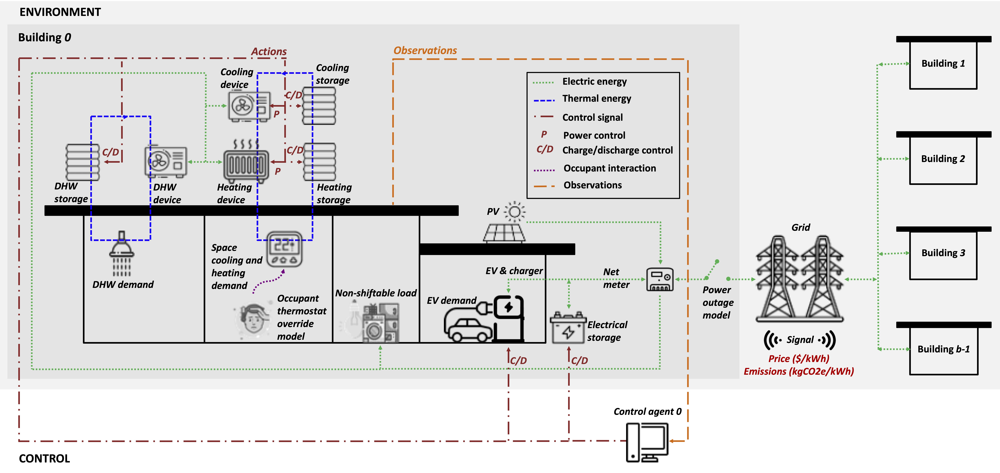

===========
Environment
===========

A CityLearn environment combines buildings, devices, input time series and a
controller interface. The schema selects the equipment and services present in
each scenario. At every timestep, controllers receive observations and return
actions; the environment applies those actions, advances device and service
states, and returns observations, rewards and episode status.

Buildings and devices
=====================

Buildings have non-shiftable electricity demand and may include PV, batteries,
EV chargers, flexible appliances and cooling, heating or domestic-hot-water
systems. Heat pumps and electric heaters supply thermal demand; thermal storage
shifts part of that supply in time. The diagram below describes the building's
thermal and electrical energy paths.

Thermal demand can come from precomputed or measured profiles. Dynamic-temperature
building models instead use a learned temperature model to relate supplied
heating or cooling to indoor conditions :cite:p:`PINTO2021117642`. This permits
partial-load control and evaluation of its comfort consequences. Device
autosizing is available through the building API, including
:meth:`citylearn.building.Building.autosize_electrical_storage` and
:meth:`citylearn.building.Building.autosize_pv`.

Communities and services
========================

In v3, scenarios can also configure total and per-phase electrical-service
limits, local energy sharing and settlement, demand-response requests, changing
members or assets, and observation or equipment failures. These features are
enabled explicitly; they are not automatically present in every dataset.
The :doc:`../guides/features` guide links each feature to its configuration,
actions and performance indicators.

Power outages constrain available grid supply. Outside an outage, a scenario
without configured electrical-service limits has an unconstrained grid
connection. Configured limits model active-power service constraints, not
distribution-network voltage or AC power flow.

Controller interface
====================

Use flat mode for fixed observation/action vectors and standard RL wrappers.
Entity mode exposes identified tables, masks and relationships and supports
dynamic topology. Central-agent mode combines the buildings' control into one
agent interface; decentralized mode provides an interface per building.
See :doc:`../guides/interfaces_flat_entity` for the exact contracts.

:doc:`../quickstart` provides a complete reset--step--evaluate loop.
:doc:`../guides/multi_community_reference` extends it to synchronized independent
communities with local and portfolio-level results.
