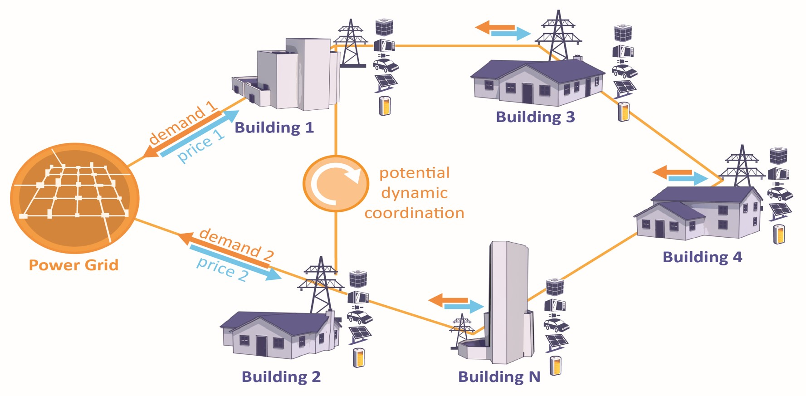

.. _overview:

=============
Core concepts
=============

Understand the model before choosing a controller. These short introductions
explain the main concepts; the linked reference guides contain complete fields,
units and interface contracts.

Building-level decisions shape the community's electricity demand. Controllers
can shift demand using storage and other flexible equipment, respond to prices
and coordinate across buildings.

   Building electricity demand, price signals and opportunities for coordinated
   control.

.. toctree::
   :maxdepth: 1

   environment
   observations
   actions
   agents
   reward_function
   dataset
   schema
   cost_function
   entity_v1_contract

For a working example, start with :doc:`../quickstart` or
:doc:`../usage/custom_controller`. To choose services and scenario conditions,
use :doc:`../guides/features`.
