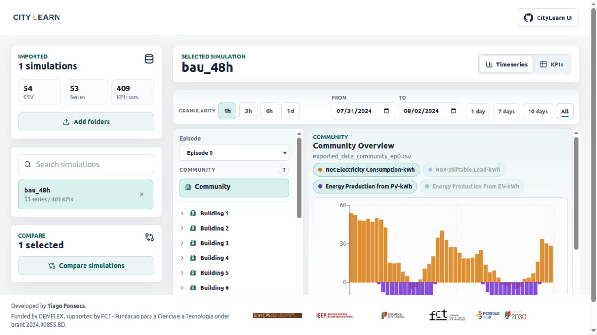
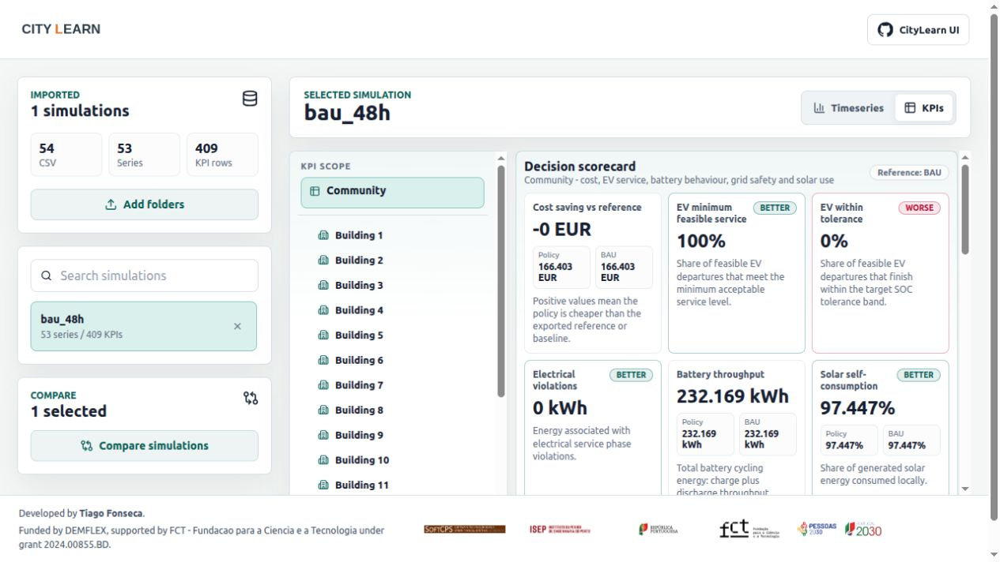

============
CityLearn UI
============

CityLearn UI opens exported simulation folders in a browser. Use it to inspect
time series, read the decision scorecard and compare runs at community, building
and component level.

* `Open CityLearn UI <https://citylearnui.netlify.app/>`_
* `Source code and local setup <https://github.com/Soft-CPS-Research-Group/citylearn-ui>`_

The current interface reads the selected CSV files locally in the browser; it
does not upload them to an application backend. Simulation setup, schemas and
controller execution remain in Python or the CLI. For configuration, start with
:doc:`guides/features` and :doc:`overview/schema`.

Export a complete run
=====================

This example runs 48 hourly states with the business-as-usual controller and
exports both time series and KPIs. It uses a public dataset available through
the installed CityLearn package.
The initial state comes from ``reset()``; the 47 subsequent transitions produce
47 time-series rows.

.. literalinclude:: ../../examples/export_for_ui.py
   :language: python

The script prints the exact folder to import, normally
``outputs/ui_exports/bau_48h`` below the working directory. Each run should have
its own session name: reusing a name also reuses its export folder.

Choose an export mode
---------------------

* ``render_mode="end"`` buffers the episode and writes the histories and final
  KPIs when it finishes. This is convenient for short interactive experiments.
* ``render_mode="during"`` writes the time series as the simulation advances
  and exports the final KPIs at episode completion. Use this to avoid buffering
  a long episode's export rows in memory.
* ``render_mode="none"`` disables automatic file export. After the episode,
  ``env.export_final_kpis(export_business_as_usual_timeseries=False)`` writes
  a KPI-only result to the configured session folder. Import the directory
  reported by ``env.new_folder_path`` to use the UI's KPIs view; there will be
  no time-series data for that run.

Use an absolute ``render_directory``, as in the example, to choose an explicit
output location. The exported folder contains ``exported_kpis.csv`` and
``exported_data_*_ep0.csv`` files for the available buildings, devices and
community. Keep the filenames unchanged so the UI can identify their contents.
The UI export is a wide table with a ``KPI`` column and one column per scope;
the Python ``evaluate_v2()`` result is a long-form table for analysis.

Import and explore
==================

1. Open the UI and click **Choose folders**.
2. Choose the printed run directory, or a parent directory containing several
   run folders. Use **Add folders** to import more results later.
3. Select a simulation in the left-hand list.
4. Switch between **Timeseries** and **KPIs** above the results.

Timeseries
----------

Choose an episode and then **Community**, a building, or an available component
in the result tree. The chart shows the columns exported for that selection.
Use the date range and granularity controls to inspect a period, and the series
buttons to show or hide individual signals. Ctrl/Cmd- or Shift-click buildings
to compare them side by side.

   Time-series exploration of the exported public example.

KPIs and the decision scorecard
-------------------------------

The **KPIs** tab provides a community/building scope selector, a **Decision
scorecard**, a larger **Selected KPIs** list and an expandable **All KPI
drill-down**. Start with cost, EV service, electrical violations, battery
throughput and solar use; open the full table when a result needs closer
inspection.

   Scorecard for the same business-as-usual run. Minimum EV service and target
   accuracy are separate measures: meeting a minimum does not imply ending
   inside the target tolerance band.

The UI presents the exported values; KPI definitions belong to the simulator's
:doc:`kpis` catalogue. See :doc:`guides/scorecard` for interpretation and
:doc:`guides/baselines` for the meaning of the native BAU reference.

Compare runs
============

Import at least two simulations, then click **Compare simulations**.
Use the imported list on the left to include or exclude runs. The first
included run in that list becomes the **Compare baseline**. This is a display
reference, distinct from the native business-as-usual comparison already
included in a run's exported KPIs.

Compare runs with matching input data, episode, timestep and service requirements.
Read the metric's units and direction together with its delta: lower cost is
desirable, while higher departure-service coverage is desirable. Some indicators,
such as battery throughput, need to be interpreted alongside cost and service.

The interface is developed in the
`CityLearn UI repository <https://github.com/Soft-CPS-Research-Group/citylearn-ui>`_.
Report interface issues there; report simulation or KPI issues in the
`CityLearn repository <https://github.com/citylearn-project/CityLearn/issues>`_.
